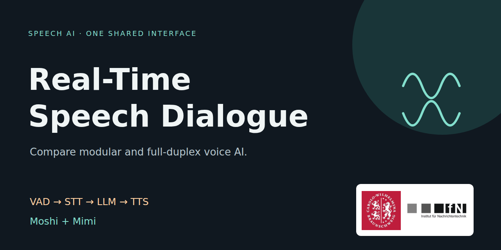
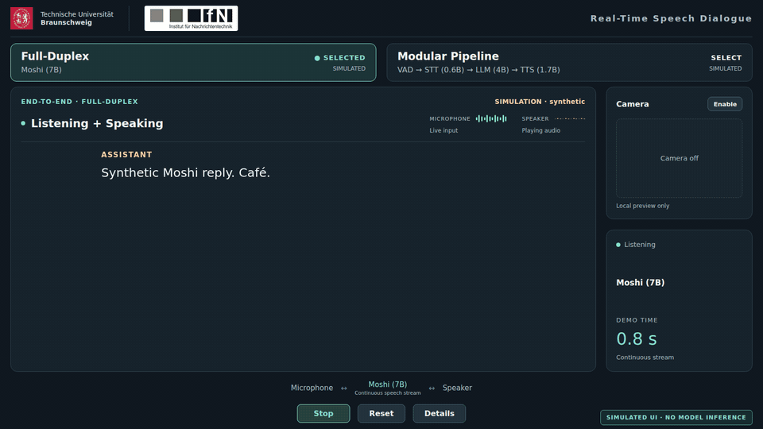
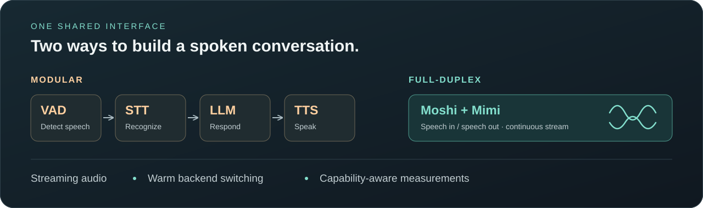
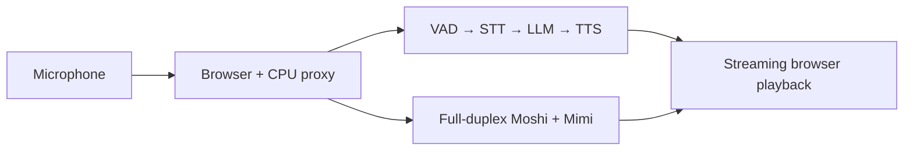

<h1 align="center">Real-Time Speech Dialogue</h1>
<p align="center"><strong>Compare modular and full-duplex voice AI in one interface.</strong></p>
<p align="center">
  <a href="LICENSE"></a>
  
  
</p>



<p align="center"><a href="#try-the-ui-without-a-gpu">Quick start</a> · <a href="docs/getting-started.md">Real backends</a> · <a href="docs/architecture.md">Architecture</a> · <a href="#built-on-open-research">References</a></p>

## See the interface



**UI simulation:** the preview uses synthetic text and tones, with camera off.
It demonstrates the interface, not model inference or a latency benchmark.
[View the static screenshot](assets/readme/demo-preview.png).

The planned real-recording trailer and walkthrough are described in
[Video production](video-production/VIDEO_PRODUCTION_PLAN.md).

## Why use it?

- **Stream a conversation.** Capture microphone audio, play streamed responses, and follow the conversation in a shared browser UI.
- **Keep both architectures warm.** Switch between Modular and Moshi without reloading model weights. Each switch starts a fresh dialogue session.
- **See what is actually supported.** Inspect readiness and available measurements in Details. Unsupported Moshi transcript and timing fields remain N/A.

This project provides the shared interface, transport adapters, backend
integration, and deployment tooling. Model inference is provided by the upstream
projects credited below.

## Two architectures, one interface





| Path | Configured models | What the UI can show |
| --- | --- | --- |
| **Full-Duplex** | Kyutai Moshi / Moshiko, 7B family, with Mimi | Assistant text/audio and continuous activity; unsupported turn metrics are N/A |
| **Modular** | Silero VAD + Smart Turn → Parakeet TDT v3 (0.6B) → Qwen3 (4B) → Qwen3-TTS (1.7B family) | User/assistant transcripts, streamed audio, and available stage/turn measurements |

Model-size labels are rounded upstream family names. Exact model revisions,
checksums, component counts, and separate model licenses are in
[Models](docs/models.md). Optional NVIDIA VoiceChat remains separately prepared
and unvalidated; Moshi is the default end-to-end model.

## Try the UI without a GPU

Install [uv](https://docs.astral.sh/uv/) and Git, then:

```bash
git clone https://github.com/ifnspaml/Realtime-Speech-Dialogue.git
cd Realtime-Speech-Dialogue
cp .env.example .env
bash scripts/setup.sh
bash scripts/run_mock.sh
```

Open **http://localhost:7860**, then **Details → Developer settings and simulation → Run simulated turn**.
No model weights, GPU environment, or inference service is installed by this
quick start. Mock text, tones, and measurements are clearly labeled synthetic.
Authorized GitHub access is required while the repository is private.

For real speech dialogue, follow [Backend setup](docs/getting-started.md).
The UI/proxy stays on CPU; Modular and Moshi use separate warm GPU services.
See [Deployment](docs/deployment.md) for the pinned CUDA/PyTorch environments,
memory guidance, cache configuration, generic Slurm templates, and SSH access.

## Built on open research

- **[Moshi / Mimi — Kyutai](https://github.com/kyutai-labs/moshi):** the full-duplex speech model, streaming codec, and official inference implementation. See the [Moshi paper](https://arxiv.org/abs/2410.00037).
- **[Speech-to-Speech — Hugging Face](https://github.com/huggingface/speech-to-speech):** the modular inference pipeline and the frontend worklets adapted by this project.
- **[Parakeet TDT v3 — NVIDIA](https://huggingface.co/nvidia/parakeet-tdt-0.6b-v3):** modular speech recognition.
- **[Qwen3](https://huggingface.co/Qwen/Qwen3-4B-Instruct-2507) / [Qwen3-TTS](https://huggingface.co/Qwen/Qwen3-TTS-12Hz-1.7B-CustomVoice):** modular language generation and speech synthesis; [GGUF conversions](https://huggingface.co/Serveurperso/Qwen3-TTS-GGUF) provide the configured TTS weights.
- **[Silero VAD](https://github.com/snakers4/silero-vad) / [Smart Turn](https://github.com/pipecat-ai/smart-turn):** speech activity detection and endpointing.

Full attribution and separate licenses are preserved in
[Third-party notices](THIRD_PARTY_NOTICES.md). Please credit the upstream models
and frameworks when using them. [Citation guidance](docs/citation.md) includes
Moshi's official BibTeX; this repository also provides [CITATION.cff](CITATION.cff).

## Tests and contributions

```bash
node --test tests/unit/*.test.mjs tests/protocol/*.test.mjs
.venv-tools/bin/python -m unittest discover -s tests/unit
.venv-tools/bin/python -m unittest discover -s tests/integration
```

[Manual CPU checks](https://github.com/ifnspaml/Realtime-Speech-Dialogue/actions/workflows/ci.yml)
can exercise synthetic browser flows when requested; content pushes do not trigger a rebuild. [Contributing](CONTRIBUTING.md) explains
local browser checks. Synthetic checks establish UI/protocol behavior, not real
model quality. See [Validation and limitations](docs/validation.md).

Current limitations include one dialogue session per backend, bounded audio
queues, Moshi's limited transcript/event information, and unresolved modular
dependency advisories. Optional camera preview is local and unused by inference.
These demo services require a trusted network or SSH/HTTPS; they do not provide
public multi-user authentication.

## License and acknowledgement

Project-owned code and new project artwork use **Apache-2.0**. Vendored files,
upstream dependencies, model weights, and optional NVIDIA containers retain their
own terms. TU Braunschweig and IfN logos retain separate institutional rights;
see [branding provenance](assets/branding/README.md) before public distribution.
See [LICENSE](LICENSE), [NOTICE](NOTICE), and the third-party notices.

Developed at the Institute for Communications Technology (IfN),
TU Braunschweig. Maintained by [Zhengyang Li](https://github.com/joyolee) and contributors.

**If this demo helps your voice AI work, consider giving the repository a star.**
