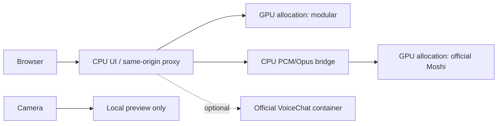

# Architecture

## Runtime boundaries

`scripts/run_demo.py` serves static HTML/CSS/ES modules, `/api/config`,
`/api/status`, `/mock`, and same-origin WebSocket proxies. It performs no GPU
inference. `services/health.py` polls configured backend health; a configured
URL alone is not READY. `frontend/backends.js` defines backend capabilities.

`scripts/run_modular.sh` launches the frozen Hugging Face speech-to-speech
upstream through `scripts/backend_entry.py`: Silero VAD + Smart Turn endpointing,
Parakeet TDT, Qwen3 Transformers FP16 LLM, Qwen3-TTS GGML BF16 talker and codec.
Its Python environment and GPU allocation are independent of Moshi.

`scripts/run_end_to_end.sh` loads configuration and runs
`services/end_to_end.py`, which supervises one resident end-to-end model, defaults to
Moshi, owns only its own process groups and publishes atomic generation state.
`scripts/launch_moshi_slot.sh` starts the official `moshi.server` and
`services/moshi/adapter.py`. The adapter translates browser PCM/JSON into native
Opus/binary `/api/chat` frames; it performs no model inference. A WAV transport
probe verifies text and nonzero output before READY; it does not certify answer
quality. The optional Nemotron launcher uses the official NVIDIA container.

Modular and the resident end-to-end service remain warm concurrently. Selecting
an architecture closes the old WebSocket, clears transient UI state and connects
to the existing service. It never invokes Slurm or requests model replacement.
There is no shared GPU requirement. Each current backend supports one active
session; concurrent visitors can receive a busy response.

## Audio and presentation

Browser capture/playback uses the adapted Hugging Face worklets: 24 kHz mono
PCM16 little-endian in base64 WebSocket messages. Capture chunks are 40 ms for
modular and 80 ms for end-to-end. Moshi retains per-session Opus state and sends
an 80 ms silent preroll. Output is capped at 30 seconds; upload backpressure
stops capture above 192,000 buffered bytes. Overflow is visible. Old-session
messages cannot populate a new conversation.

The landscape layout, diagrams and internally scrolling history are preserved.
The optional camera has no network upload or inference path. Microphone input
level measures locally captured PCM, not recognition or server acknowledgement.
Optional local recording is bounded to 30 seconds and downloaded by the browser;
it is not collected by the backend.

Reset clears presentation/audio/timing without clearing model context or camera.
Reconnect creates a fresh session. Details holds measurements and developer
controls. Unsupported metrics remain N/A. Moshi emits assistant text/audio but
no user transcript, speech boundaries, stage durations or per-turn completion.
Its Demo time is cumulative microphone time, not inference latency. Modular
history displays user and assistant text; optional Nemotron technical user text
stays in Details. Arrival, first rendered audio and model stage times are distinct.

## Optional model replacement and test modes

Leave `VOICE_DEMO_SLOT_CONTROL` unset for presentation use. Explicit private
operator replacement can be enabled with `VOICE_DEMO_SLOT_CONTROL=1` on the UI
and a shared `VOICE_DEMO_SLOT_DIRECTORY`; it intentionally unloads the resident
end-to-end model. The separate modular process remains warm. Do not expose this
unauthenticated operator API publicly. The browser never calls it on page load,
Reset, Reconnect or architecture switching.

The mock generates protocol text and tones. Replay requires an explicit fixture
and checksum verification; included fixtures are handwritten synthetic events
and locally generated tones, with no real speaker recording. Session metadata
forces a replay/synthetic badge. Neither mode is real inference evidence.
